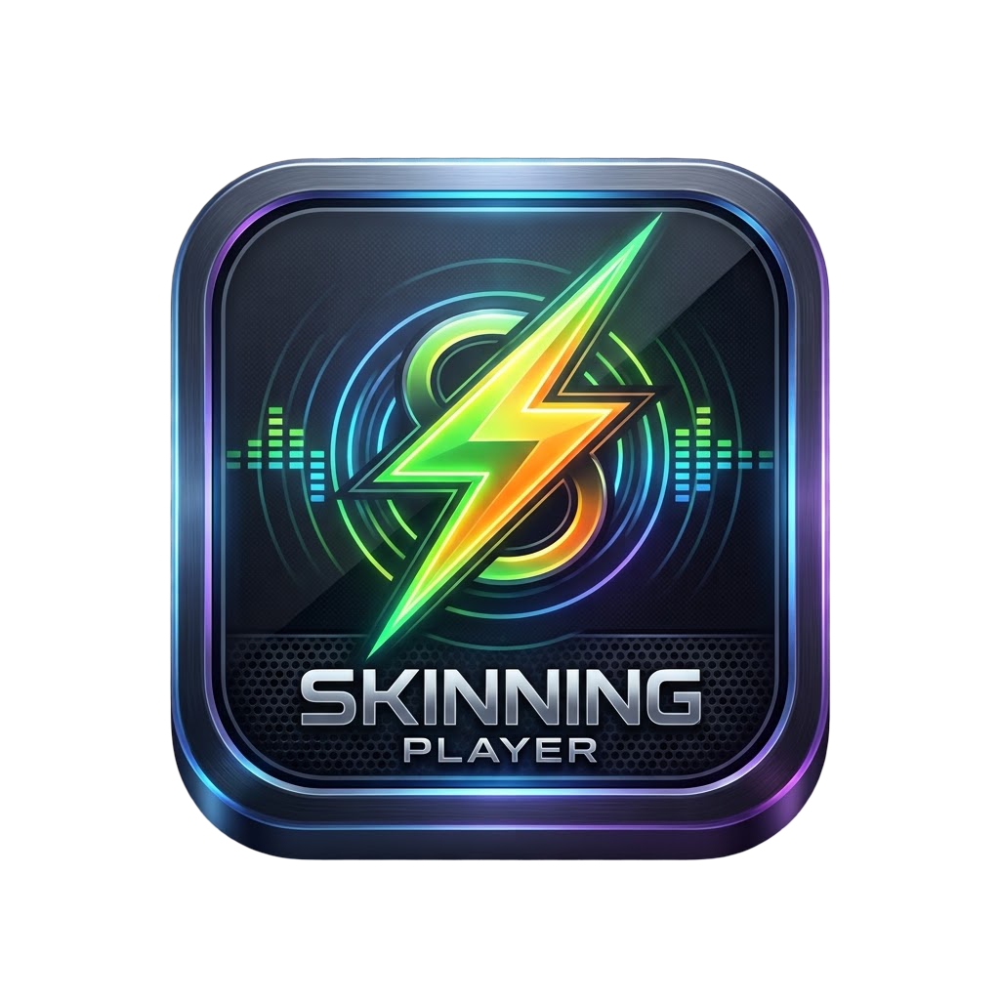

<p align="center">
  
</p>

# Skinning Player

Skinnable Android music player built with [Angular Native](https://ng-native.com) (Angular 22 on
Expo SDK 57). It lists the audio files on the device (MP3, WAV, FLAC, M4A/AAC, Ogg, Opus and the
other formats Android decodes), plays them with background playback and
lock-screen controls, keeps playlists, and loads Winamp-style skins at runtime: the menu, every
button and the widgets (mini player, LCD display, visualizer, seek bar) are drawn from the active
skin.

## Run it

Requirements: Node 24, JDK 17, the Android SDK (`ANDROID_HOME`) and an emulator or a device.

```sh
npm install
npm run android   # builds the development app and installs it (first build takes a while)
npm start         # Metro, for the installed development app
npm test          # unit and component tests, in Node, no device needed
npm run typecheck
```

The media library needs a development build (`npm run android`), not Expo Go. To try it on an
emulator without music, push a few files and rescan:

```sh
adb push "Artist - Title.mp3" /sdcard/Music/
adb shell content call --method scan_volume --uri content://media --arg external_primary
```

## Layout

| Path | What lives there |
|---|---|
| `src/app/core/` | Tracks, the device music library, playlists, covers, the play queue and the audio engine. |
| `src/app/skins/` | The skin format, its validator, the built-in skins and `SkinManager`. |
| `src/app/ui/` | Skinned building blocks: buttons, icons, the tab menu, sheets, track rows. |
| `src/app/widgets/` | Mini player, LCD display, visualizer and seek bar. |
| `src/app/screens/` | Library, playlists, skins and the full-screen player. |
| `src/app/i18n/` | The app's strings in English and Spanish, and the `I18n` service that picks one. |
| `skins/` | Example skin files to copy to a phone and load. |

## Language

The app speaks English and Spanish. It follows the phone's preferred languages, taking the first
one it has and English otherwise; the language button in the header (`EN`/`ES`) picks one for the
app instead, or goes back to the phone's. Every string lives in `src/app/i18n/messages.ts`, where
English defines the shape: a Spanish string missing, or taking different arguments, fails the
typecheck. The phone's language is read through `expo-localization`, so a development build made
before it was added needs rebuilding (`npm run android`); until then the app starts in English.

## Covers

A tap on a song plays it and opens the full player, with the song's cover as large as fits. The
cover is, in order: an image you chose for the song, the art embedded in the file (an MP3's ID3v2
tag, a FLAC's PICTURE block, a WAV's `id3 ` chunk or an M4A's `covr` atom), or a placeholder in
the skin's display colors. Set or change a song's image with the cover button in
the full player, or from the song's menu (the "more" button) in the library. Chosen images are
copied into the app's storage, so the original can be deleted; embedded art is read once and kept
in the cache.

## Skins

A skin is a JSON file. Load it from the **Skins** tab with **Load skin file**. It is validated
before it is installed: an invalid value is ignored with a warning and the base skin fills the gap,
so a skin only has to list what it changes (like a Winamp skin missing a bitmap).

```json
{
  "format": 1,
  "id": "my-skin",
  "name": "My Skin",
  "author": "Me",
  "description": "Optional, shown on the skin card.",
  "extends": "classic",
  "statusBar": "light",
  "colors": { "accent": "#ff5500", "displayText": "#ff5500" },
  "shape": { "radius": 12, "buttonRadius": 24, "widgetRadius": 12, "borderWidth": 1 },
  "fonts": [
    { "family": "Inter", "weight": 400, "src": "https://example.com/Inter-Regular.ttf" },
    { "family": "Inter", "weight": 700, "src": "https://example.com/Inter-Bold.ttf" }
  ],
  "typography": {
    "fontFamily": "Inter",
    "displayFontFamily": "monospace",
    "scale": 1,
    "weights": { "regular": 400, "medium": 600, "bold": 700 }
  },
  "images": { "background": "https://example.com/bg.jpg", "backgroundOpacity": 0.4, "backgroundResize": "cover" },
  "icons": { "play": "<svg viewBox=\"0 0 24 24\"><path fill=\"currentColor\" d=\"M8 5v14l11-7z\"/></svg>" },
  "widgets": { "visualizer": true, "visualizerBars": 20, "miniDisplay": true },
  "motion": {
    "speed": 1,
    "easing": "ease-out",
    "pressScale": 0.96,
    "pressOpacity": 0.7,
    "sheetTransition": "fade",
    "playerTransition": "slide",
    "displayEffect": "none"
  }
}
```

- **`extends`**: `classic`, `neon`, `paper` or `ocean`. Everything not listed comes from it.
- **`colors`**: `background`, `surface`, `surfaceAlt`, `border`, `text`, `textMuted`, `accent`,
  `accentText`, `danger`, `menuBackground`, `menuText`, `menuActiveBackground`, `menuActiveText`,
  `buttonBackground`, `buttonText`, `buttonBorder`, `primaryBackground`, `primaryText`,
  `widgetBackground`, `widgetBorder`, `widgetText`, `displayBackground`, `displayText`,
  `progressTrack`, `progressFill`. Hex, `rgb()`, `rgba()`, `hsl()`, `hsla()` or a color name.
- **`shape`**: corner radii from 0 to 40 and a border width from 0 to 6, in points.
- **`fonts`**: up to 8 `.ttf` or `.otf` files the skin ships, each a `family`, a `weight` (100 to
  900, 400 by default) and a `src` (`https://`, `file://` or `data:font/ttf;base64,`). They are
  downloaded and registered when the skin is applied. A skin's faces are laid over the ones it
  inherits; `null` drops them all.
- **`typography`**: the body and display families, each one from `fonts` or a family the system
  has (`sans-serif`, `serif`, `monospace`, `sans-serif-condensed`, `sans-serif-light`...), a size
  scale from 0.8 to 1.4, and the weight of `regular` text, `medium` labels and `bold` titles. With
  a shipped family, each weight draws the nearest face, as CSS picks one.
- **`images.background`**: an `https://`, `file://` or `data:image/...;base64,` URI.
- **`icons`**: SVG markup per button, drawn in the button's color through `currentColor`. Slots:
  `play`, `pause`, `previous`, `next`, `shuffle`, `repeat`, `repeatOne`, `library`, `playlists`,
  `skins`, `add`, `addToPlaylist`, `more`, `close`, `back`, `remove`, `rename`, `search`,
  `import`, `check`, `refresh`, `cover`, `warning`. `null` restores the default icon.
- **`widgets`**: show or hide the visualizer (4 to 32 bars) and the mini player's display.
- **`motion`**: `speed` from 0 to 4 (0 turns motion off), an `easing` (`linear`, `ease`,
  `ease-in`, `ease-out`, `ease-in-out`, `smooth`, `snappy`, `bouncy`), how a pressed button
  shrinks (`pressScale`, 0.8 to 1) and fades (`pressOpacity`, 0.2 to 1), how sheets and the full
  player come in (`slide`, `fade` or `none`), and a looping `displayEffect` on the LCD (`none`,
  `pulse`, `flicker`, or `blink`, which blinks the time while paused).

Under the hood each value becomes a CSS custom property (`--sk-accent`, `--sk-button-radius`,
`--sk-font-md`...) set on the root view; every component stylesheet reads those, so a new skin
restyles the whole app without a rebuild. `skins/` has two complete examples.
